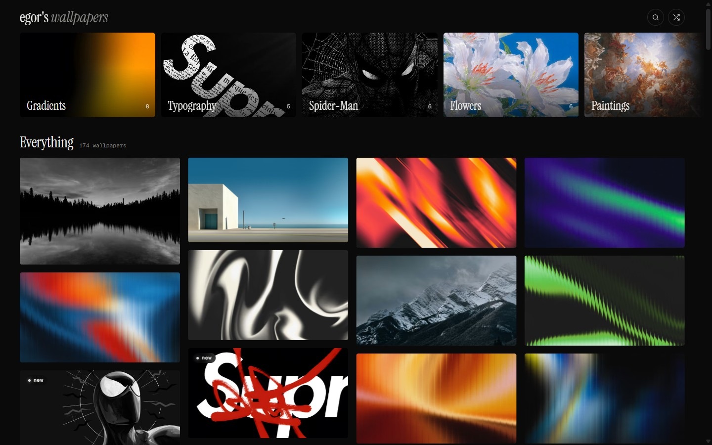
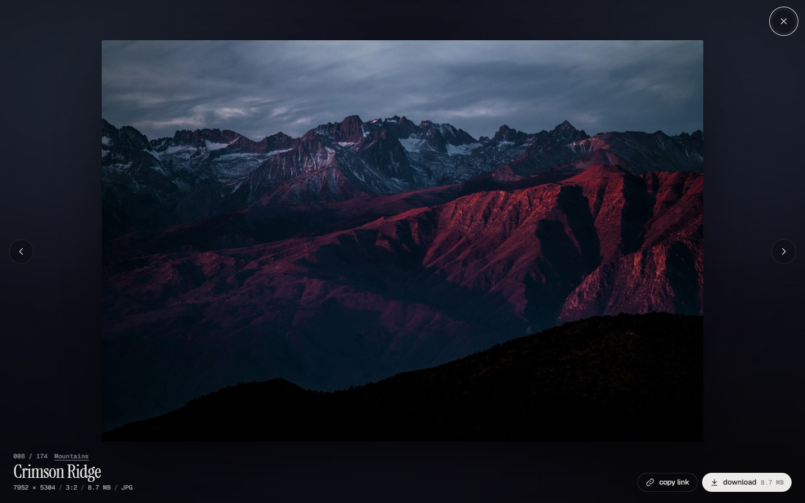

Want to help out with the project (recommendations, new wallpapers, etc.)?
- Add me on discord: @o8mu      or telegram: [exfxx](https://t.me/exfxx)

# egor's wallpapers

A quiet, dark gallery for my wallpaper collection. Browse, preview, and download the originals at full resolution.

**→ [wp.egorz.com](https://wp.egorz.com)**





## Features

- One "Everything" wall of every wallpaper, with collections (Fractal Maze, Mountains, …) as shortcuts to their own pages
- Search that forgives typos and knows collection names and colors, plus random / newest / oldest / popular sorting and a color filter
- Viewer with zoom down to the original pixels, swipe and keyboard navigation
- Creator pages (`/by/<name>/`) for wallpapers made by other people
- One-click original downloads and a share link for every wallpaper

## How it works

The original files live in a Cloudflare R2 bucket. [`wallpapers.json`](wallpapers.json) lists them (name, content hash, collection, date, credit) and [`collections.json`](collections.json) lists the collections (the site shows the most recently updated first); the admin page at `/admin/` uploads files and edits both. On every push, a small Node build script uses [sharp](https://sharp.pixelplumbing.com) to generate thumbnails, previews, color tags and link-preview images, and writes a static site to `dist/`: a page per wallpaper (`/w/<name>/`) and per collection (`/c/<id>/`), plus a `_redirects` file so every older link keeps working after a rename. Images that haven't changed are reused from the previous deploy, so a new upload only processes what's new. Cloudflare Workers serves the result, and streams original downloads from R2.

No framework, just plain HTML, CSS and JavaScript.

```sh
npm install
npm run dev   # build and preview at http://localhost:8788
npm test      # data, build, search and admin-rule tests
npm run deploy  # build and deploy straight to Cloudflare (if a push to main does not deploy)
```
